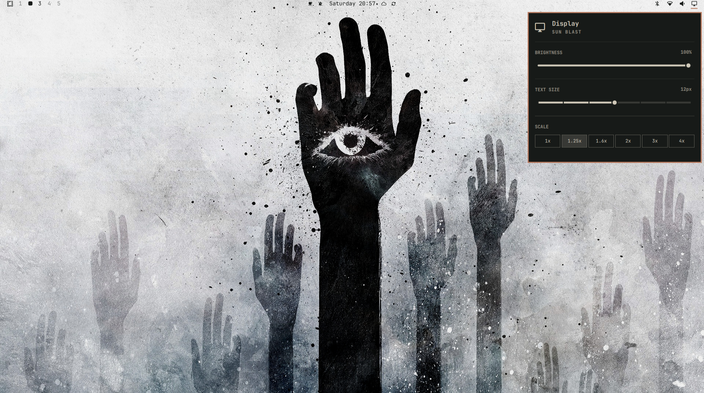

# Nocturne — Omarchy Theme

A dark, cinematic Omarchy theme built around charcoal backgrounds, warm ivory text, ember accents, moss green, smoke blue, and dusty plum.

Nocturne combines a muted colour palette with an atmospheric wallpaper collection for a cohesive desktop experience.

## Preview



## Features

- **Dark cinematic aesthetic** — charcoal backgrounds and warm, subdued foreground colours.
- **Muted colour palette** — ember, moss green, smoke blue, and dusty plum accents.
- **Wallpaper collection** — cinematic, surreal, and atmospheric backgrounds.
- **Yaru icons** — uses the default Yaru icon theme.
- **Terminal palettes** — includes styling for Kitty, Alacritty, and Ghostty.
- **Desktop styling** — includes configuration files for supported Omarchy components and applications.

## Installation

### Method 1: Install through the terminal

The recommended installation method is Omarchy's theme installer.

```bash
omarchy-theme-install https://github.com/adas-codes/omarchy-nocturne-theme.git
```

After installation, select **Nocturne** from the Omarchy theme selector.

Official guidance: [Omarchy Themes](https://omarchy.org/themes/)

### Method 2: Install manually using Git

Clone the repository into your Omarchy themes directory:

```bash
git clone https://github.com/adas-codes/omarchy-nocturne-theme.git \
  ~/.config/omarchy/themes/nocturne
```

Then select Nocturne using the Omarchy theme selector.

If the destination directory already exists, back it up or choose another location before cloning.

### Method 3: Install through the Omarchy theme menu

1. Open the Omarchy theme menu using `Super + Ctrl + T`.
2. Choose the option to install a theme from a Git repository.
3. Paste the SSH repository URL:

   ```text
   git@github.com:adas-codes/omarchy-nocturne-theme.git
   ```

4. Confirm the installation and select **Nocturne** once it becomes available.

This method requires SSH authentication with GitHub. Ensure your SSH key is configured before installing.

Menu labels and workflows may vary between Omarchy versions.

## Theme Contents

| File or directory | Purpose |
|---|---|
| `colors.toml` | Omarchy semantic colour palette |
| `backgrounds/` | Wallpaper collection |
| `preview.jpg` | Theme preview displayed above |
| `icons.theme` | Icon theme selection |
| `alacritty.toml` | Alacritty terminal styling |
| `ghostty.conf` | Ghostty terminal styling |
| `kitty.conf` | Kitty terminal styling |
| `btop.theme` | btop colour theme |
| `chromium.theme` | Chromium theme colour configuration |
| `hyprland.conf` | Hyprland window-border styling |
| `hyprlock.conf` | Hyprlock styling |
| `mako.ini` | Mako notification styling |
| `waybar.css` | Waybar styling |
| `walker.css` | Walker styling |
| `swayosd.css` | SwayOSD styling |
| `neovim.lua` | Optional Neovim integration placeholder |
| `vscode.json` | Optional VS Code integration placeholder |
| `LICENSE` | MIT license |

## Wallpapers

The `backgrounds/` directory contains the wallpapers bundled with Nocturne, including cinematic landscapes and surreal artwork.

Wallpaper cycling and selection behaviour depend on your Omarchy version.

## Application Compatibility

Nocturne includes configuration files for several applications and desktop components. Actual integration depends on the application and Omarchy version.

**Important:** Omarchy's Git-based theme installer filters certain configuration files, including Lua files, terminal-specific configuration files, and `vscode.json`. These files may not be installed automatically when using the Git-based installation methods.

Additional notes:

- `neovim.lua` does not install or force a third-party Neovim colourscheme.
- `vscode.json` is a placeholder for optional VS Code integration and must be configured for a real extension before use.
- Terminal configuration files may need to be applied manually if they are filtered during installation.
- `hyprland.conf` defines Nocturne's window-border colours; it does not automatically enable window transparency.
- Application behaviour may vary across software versions.

## Icon Theme

Nocturne uses the Yaru-sage-dark icon theme through `icons.theme`.

You can change this setting to another installed icon theme if you prefer a different appearance.

## Customisation

Nocturne is designed to be customised.

- Modify `colors.toml` to adjust the semantic palette.
- Add or replace wallpapers in `backgrounds/`.
- Adapt supported application configuration files to suit your setup.

Back up existing configurations before making manual changes.

## Contributing

Suggestions, bug reports, and improvements are welcome. When reporting compatibility issues, include your Omarchy version and the affected application.

## Credits

- **Theme design and configuration:** Nocturne theme author
- **Theme generation:** [Aether](https://github.com/omacom/aether)
- **Desktop environment:** [Omarchy](https://github.com/basecamp/omarchy)

## License

Nocturne is distributed under the MIT License. See [`LICENSE`](LICENSE) for details.